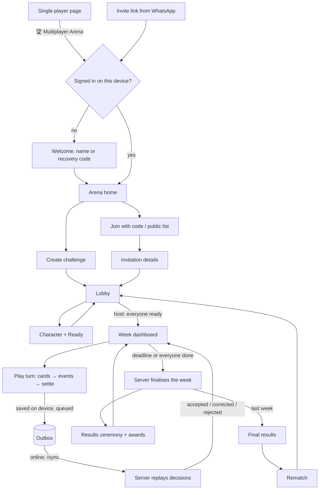
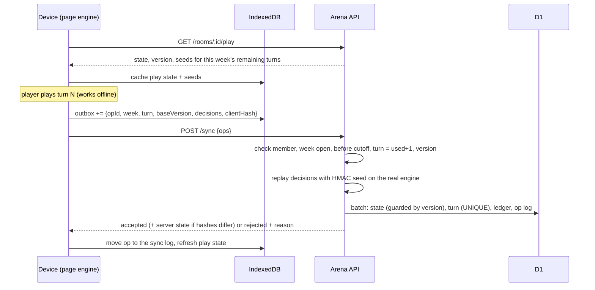

# 3. Screens and user flows

All screens live in `arena/client/arena.js` and open over the single-player page from the **🏆 Multiplayer Arena** header button (the page underneath is made `inert`). Routes are hash links (`#arena/...`) so invite links work: `https://japa-or-stay.pages.dev/#arena/invite/CODE`.

Shared behaviour on every screen:

- **Loading:** shimmer placeholders. **Error:** a panel with the reason and *Try again*. **Offline:** screens opened before show their saved copy with an "Offline copy from …" note; the top bar shows *Offline / Syncing… / N waiting to sync / Synced*.
- **Mobile:** one column under 600 px, 16 px gutters, 44 px touch targets, the back button shrinks to an arrow, tab rows scroll sideways.
- **Accessibility:** real buttons and links, visible focus rings, `aria-pressed` on toggles, `role="status"` toasts, progress bars with values, the game's reduced-motion setting plus an Arena *Reduce motion* switch (no confetti, no sliding rows).
- **Realtime:** lobby screens check `/rooms/:id/version` every 4 s and game screens every 15 s while visible and online; they refetch only when the version moved.

## Screen inventory

| # | Screen | Route | Purpose and main parts | Empty / special states |
|---|---|---|---|---|
| – | Welcome | `#arena/welcome` | Display name → anonymous account; or recovery code. Shows the recovery code once with Copy. | Invite links bounce here first and continue to the invitation. |
| 1 | Arena home | `#arena` | Player chip, headline, tiles (Create, Join, Invitations & friends, Lifetime board, Achievements, Profile, History, Sync), active challenges with week/turns/deadline/last rank, lobbies and invitations. | "No challenge running", "Nothing waiting". |
| 2 | Create challenge | `#arena/create` | Every room setting, segmented choices, optional start date, rename awards. | Validation errors inline. |
| 3 | Join challenge | `#arena/join` | Code entry and the list of public lobbies. | "No public lobbies right now". |
| 4 | Invitation details | `#arena/invite/CODE` | Room name, host, players, rules summary, Join. | Started/ended/full rooms disable Join and say why. |
| 5 | Challenge lobby | `#arena/room/ID` (lobby) | Seats with avatars and Ready chips, open seats, join requests (host), invite code, copy link, WhatsApp share, system share, invite friends, rules, settings, cancel, start / leave. | Pending players see "waiting for the host"; cancelled rooms say so. |
| 6 | Player ready (character) | `#arena/room/ID/character` | Name, look (shuffle or "use my single-player look"), home city, trait; then *I'm ready*. | Locked after the start. |
| 7 | Challenge rules | `#arena/room/ID/rules` | The room's actual numbers: weeks, turns, deadline, autopilot, offline rules, money formula, tie-breaks, Life Balance weights, awards. | Works offline. |
| 8 | Character overview | `#arena/room/ID/me` | Portrait, career, place, path, the seven measures, life progress (job, skills, passport, test, offer, debts, assets), recent life log. | Before the start: explains it appears later. |
| 9 | Life decision | `#arena/room/ID/play` | One turn on the real engine: card plan (blocks bar, costs, tags), events with choices, results with effect chips, settle-up ledger, Year-2 choice, turn summary, *Play next turn*. | Offline: "saved on this device". Closed week: explains turns would not count. Stale half-turn: discarded with a notice. |
| 10 | Weekly progress dashboard | `#arena/room/ID` (active) | Week x of y, countdown, turn pips (synced / waiting / next), Play button, my measures, live money table, links. | All turns used; story complete; never-downloaded week offline. |
| 11 | Financial leaderboard | `#arena/room/ID/board` (Money, Net worth tabs) | Rank medals, avatars, career and place, eligible cash with cash/dollars underneath, rank-change arrows, money crowns, badges, turn progress, online dot. Animated reordering. | "Live and provisional" vs "Official" label; offline copy note. |
| 12 | Character stats leaderboard | same, Strength…Clout tabs | Same rows sorted by each stat. | "stats private" in money-only rooms. |
| 13 | Life Balance leaderboard | same, Life Balance / Weekly improvement tabs | Weekly improvement only for official weeks. | |
| 14 | Player comparison | `#arena/room/ID/compare/PID` | Me vs them on every measure with winners highlighted; rivalry record across challenges. | Hidden stats shown as "—". |
| 15 | Weekly results ceremony | `#arena/room/ID/week/N` | Staged reveal, crown line, podium, confetti and fanfare (first view only, respects reduced motion and sound setting), highlights, my week (rank change, deltas, moves, autopilot marks, unlocks), share card, standings with emoji reactions, next-week preview. | Not-final weeks return a clear message. |
| 16 | Weekly award winners | within 15 | Every award with winner(s) and the deciding number; shared awards list all names. | |
| 17 | Lifetime leaderboard | `#arena/leaderboard` | Everyone with a public profile: money crowns, best cash, awards, achievements. | Empty until weeks finish. |
| 18 | Multiplayer profile | `#arena/profile[/ID]` | Avatar, names, join date, competitions, crowns, category wins, records, financial journey chart, achievements, challenges; for me: display name, crown title, privacy, reduce motion, recovery code, friend code. Report button on others. | Private profiles show only the name. |
| 19 | Achievements | `#arena/achievements` | All 14, unlocked highlighted. | |
| 20 | Challenge history | `#arena/history` | Finished challenges with final rank. | "No finished challenges yet". |
| 21 | Friends and invitations | `#arena/friends` | Friend code, add by code, requests (accept/reject), friends with online dot, rivalry links, challenge invitations; with `?room=ID` tick friends and invite. | "No friends yet". |
| 22 | Offline sync status | `#arena/sync` | Online state, Sync now, queued turns with attempts and last error, accepted / corrected / rejected history with reasons. | "Nothing waiting". |
| 23 | Challenge settings | `#arena/room/ID/settings` | The create form, prefilled; host and lobby only. | Locked message otherwise. |
| 24 | Final results | `#arena/room/ID/final` | Season champion(s), final table, every week's results, rematch. | |
| – | Money journey | `#arena/room/ID/journey` | Eligible cash and net worth chart, character development chart, lifetime gains/losses/highs/averages, money by category, full ledger. | |
| – | Rivalry | `#arena/rival/ID` | Head-to-head weeks, wins/losses/ties, cash difference, category record. | |

## Main flow

## Turn sync sequence

